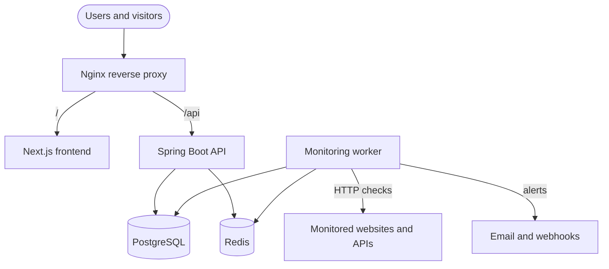

# CloudPulse Architecture Overview

## High-level architecture

## Components

| Component | Responsibility | Talks to |
|---|---|---|
| Nginx | Entry point, routing, later HTTPS | Frontend, API |
| Frontend (Next.js) | Dashboard, login, monitor pages, status pages | API (through Nginx) |
| API (Spring Boot) | Business rules, authentication, REST endpoints | PostgreSQL, Redis |
| Worker (Spring Boot) | Scheduled checks, failure rules, incidents, notifications | PostgreSQL, Redis, targets, email |
| PostgreSQL | Permanent data: users, monitors, results, incidents | API, worker |
| Redis | Job queue and locks | API, worker |

## Key design choices

- **Modular monolith.** One backend codebase, run as two processes:
  the API and the worker. We do not split into many microservices.
- **Same origin.** The browser talks only to Nginx. Frontend pages and
  API calls share one address, so there are no CORS problems.
- **Worker is separate.** Monitoring continues even if no one uses the
  dashboard, and slow checks never block API requests.

## Local and cloud

| | Local | Cloud (AWS) |
|---|---|---|
| How it runs | Docker Compose, one command | Decided in Phase 15 |
| Database | PostgreSQL container | Managed database (planned) |
| Redis | Redis container | Container or managed Redis |
| Email | Mailpit container (catches test emails) | AWS SES or SMTP |
| Entry point | Nginx container | Nginx plus a load balancer |

## Not in version 1

Kubernetes, message brokers such as RabbitMQ, multi-region checks, many
microservices.
