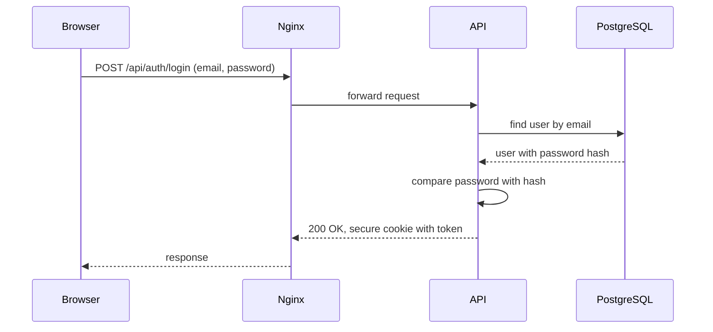
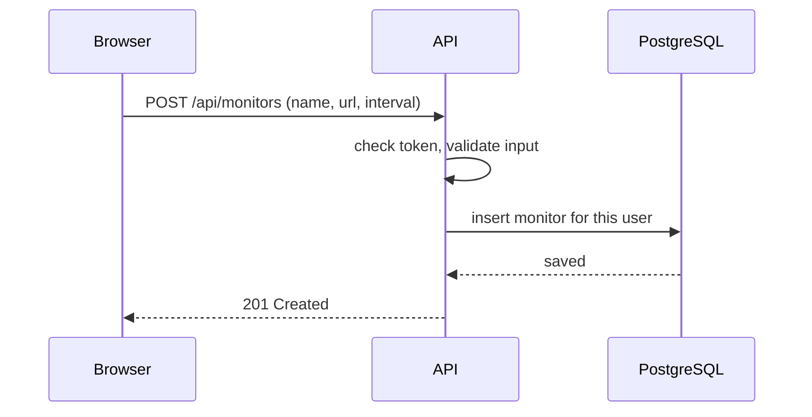
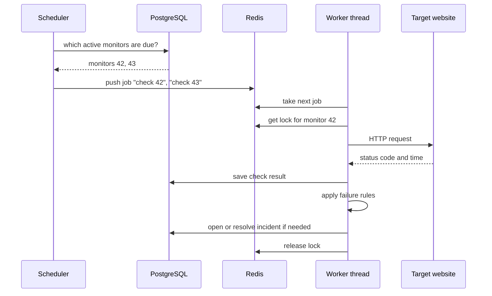
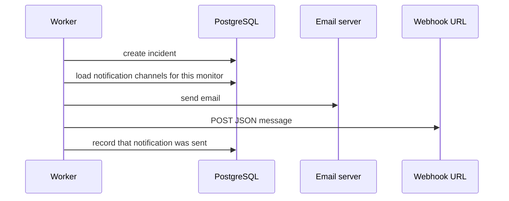
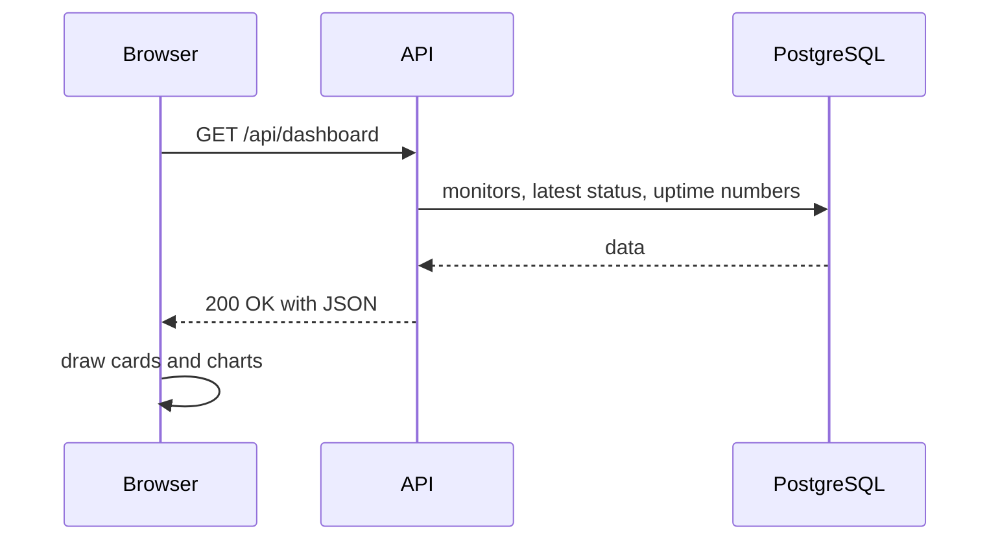

# CloudPulse Communication Flows

## 1. Sign in

## 2. Add a monitor

## 3. Scheduled check (no user involved)

## 4. Incident notification

## 5. Open the dashboard

## Who talks to whom

| From | To | Protocol |
|---|---|---|
| Browser | Nginx | HTTP, later HTTPS |
| Nginx | Frontend, API | HTTP |
| API, Worker | PostgreSQL | SQL over TCP |
| API, Worker | Redis | Redis protocol over TCP |
| Worker | Target websites | HTTP or HTTPS |
| Worker | Email server | SMTP |
| Worker | Webhook URLs | HTTPS POST |
