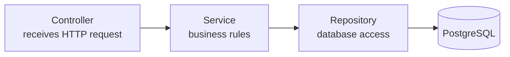
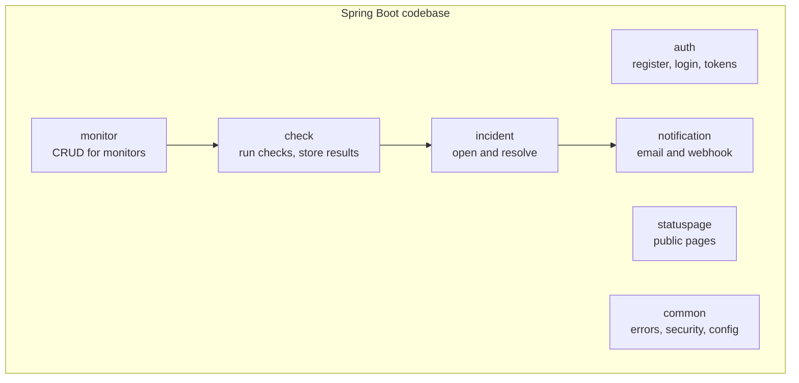
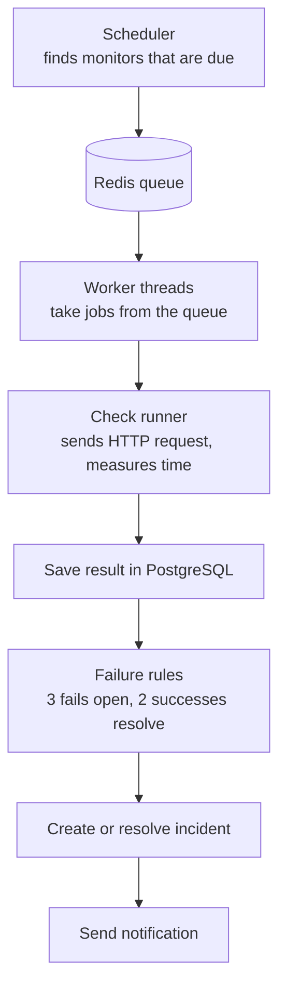

# CloudPulse Component Architecture

## Backend layers

Every request passes through the same layers.

| Layer | Job | Must NOT do |
|---|---|---|
| Controller | Read request, validate input, return response | Business rules |
| Service | Apply rules (for example the 3-failure rule) | Build HTTP responses |
| Repository | Read and write the database | Business rules |

## Backend modules (organized by feature)

## Two ways to run the same codebase

| Process | Runs | Exposes web port? |
|---|---|---|
| API | Controllers, auth, REST endpoints | Yes |
| Worker | Scheduler, check runner, incident rules, notifications | No (health check only) |

The choice is made with a configuration value (a Spring profile), so one
Docker image can start either process.

## Worker internals

Redis also holds a **lock** per monitor, so if we later run two workers
they never check the same monitor at the same time.
