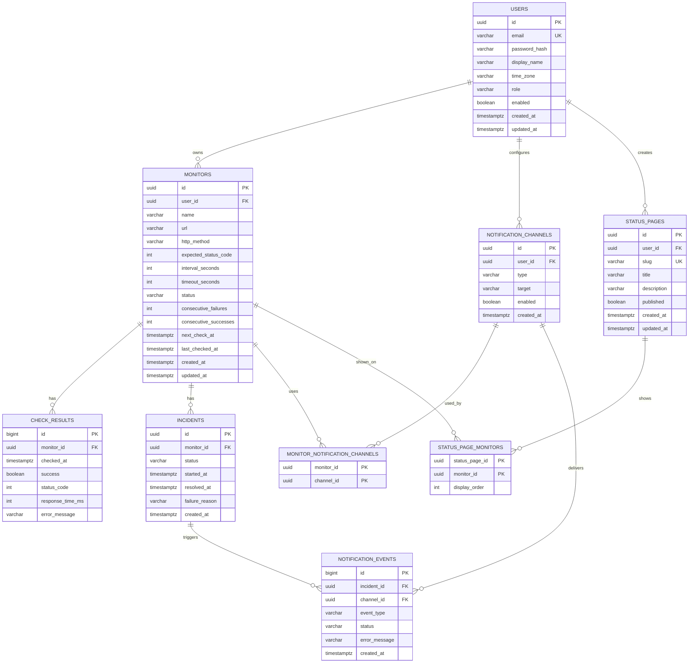

# CloudPulse Entity Relationship Diagram

## How to read the lines

`||--o{` means **one to many**: exactly one on the left, zero or many on
the right. Example: one user owns many monitors.

## Relationships

| Relationship | Type | How it is stored |
|---|---|---|
| User to monitors | One-to-many | `monitors.user_id` |
| Monitor to check results | One-to-many | `check_results.monitor_id` |
| Monitor to incidents | One-to-many | `incidents.monitor_id` |
| User to notification channels | One-to-many | `notification_channels.user_id` |
| Monitors and channels | Many-to-many | `monitor_notification_channels` |
| Status pages and monitors | Many-to-many | `status_page_monitors` |
| Incident to notification events | One-to-many | `notification_events.incident_id` |

## Design notes

- **Deleting cascades.** Deleting a user deletes their monitors, and
  deleting a monitor deletes its results and incidents (`ON DELETE CASCADE`).
- **One open incident per monitor** is enforced by the database itself
  with a partial unique index (requirement FR-46).
- **No duplicate alerts**: a unique index stops the same notification
  being recorded as sent twice (requirement FR-56).
- **Deliberate denormalization:** `consecutive_failures` and
  `consecutive_successes` live on `monitors` so the worker does not
  recount history every minute.
- **Uptime is calculated, not stored:** it comes from `check_results`
  (requirement NFR-10).
- **Retention:** a scheduled job deletes `check_results` older than
  30 days (requirement FR-42).
- **All timestamps are UTC** (`timestamptz`) (requirement NFR-11).
- **Later (not version 1):** custom request headers, incident notes,
  password reset tokens, tags.
