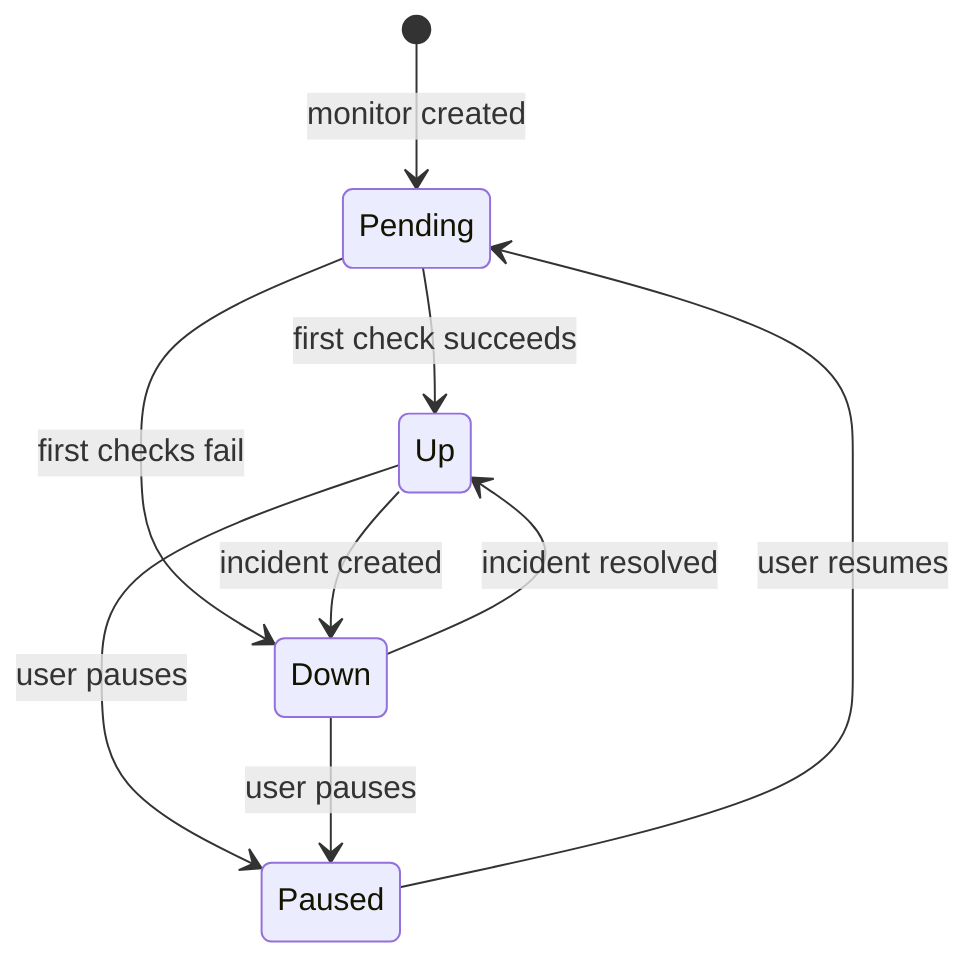
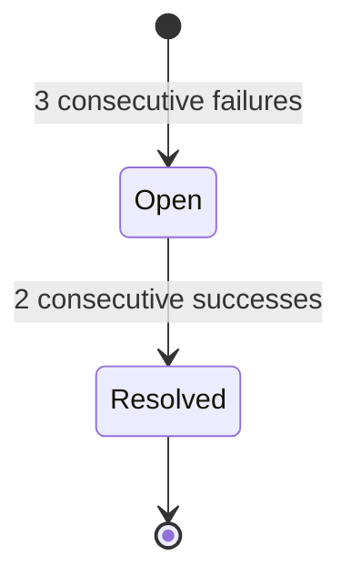
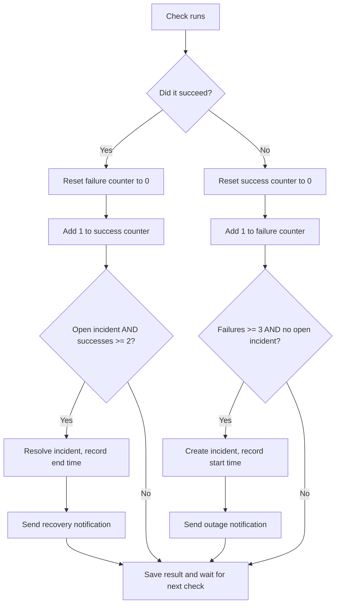
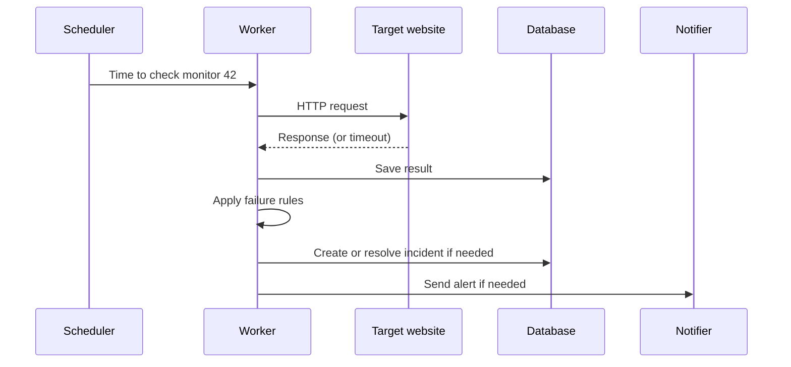

# CloudPulse Incident Workflow

## Monitor states

## Incident states

## What happens after every check

## Timeline example

| Time | Result | Failures | Event |
|---|---|---|---|
| 10:00 | Success | 0 | Nothing |
| 10:01 | Fail | 1 | Nothing (could be a glitch) |
| 10:02 | Fail | 2 | Nothing |
| 10:03 | Fail | 3 | Incident created, alert sent |
| 10:04 | Fail | 4 | Nothing (no duplicate alert) |
| 10:05 | Success | 0 (success 1) | Nothing yet |
| 10:06 | Success | success 2 | Incident resolved, recovery alert |

## What counts as a failed check

- Request times out
- DNS or connection error
- Status code is not the expected one

## Check flow between components

The rules (3 failures, 2 successes) are settings. We tune them in Phase 8.
