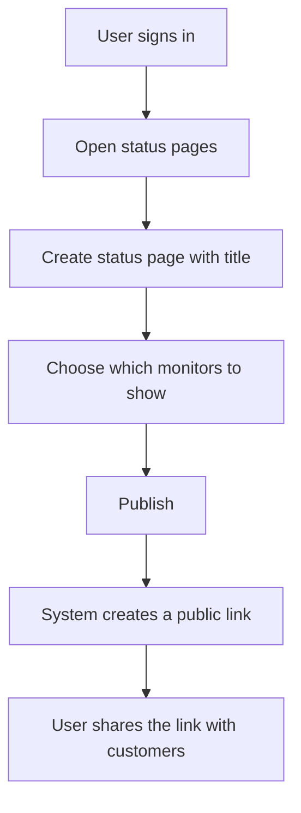
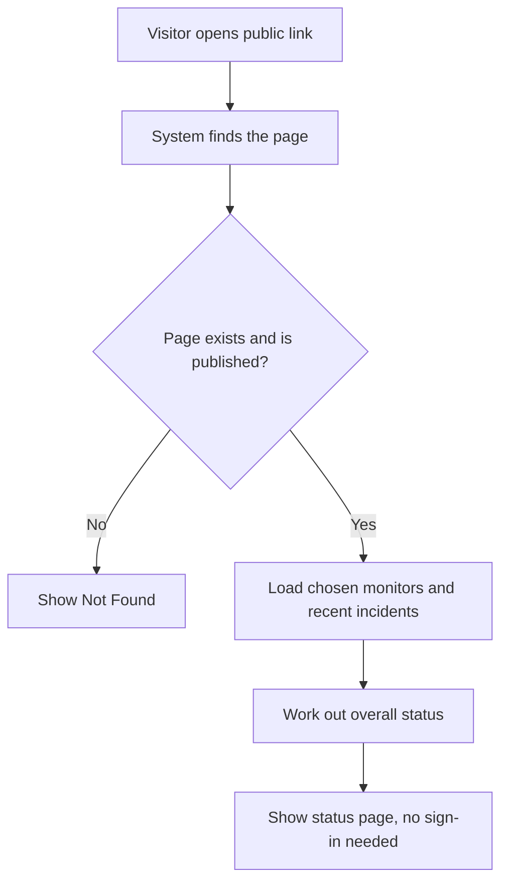

# CloudPulse Status Page Workflow

## Owner creates a status page

## Visitor opens the page

## Overall status rules

| Situation | Overall status |
|---|---|
| All monitors Up | Operational |
| Some monitors Down | Partial outage |
| All monitors Down | Major outage |
| Paused monitors | Not counted |

## Privacy rule

A public page shows only the monitors the owner chose, and never
shows private data such as email addresses or request headers.
