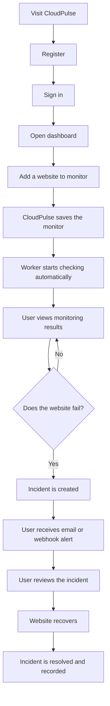
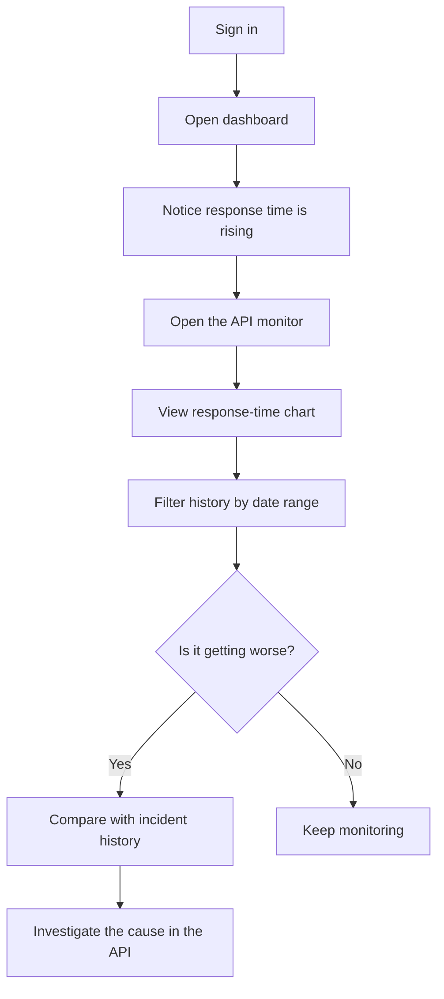
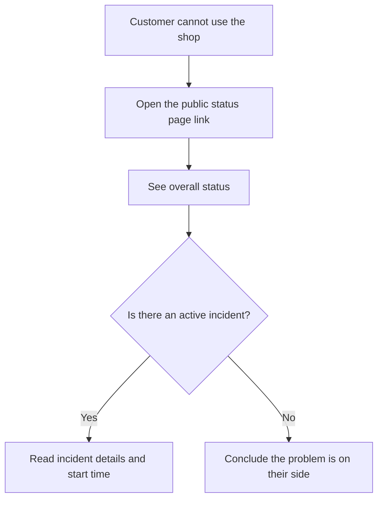
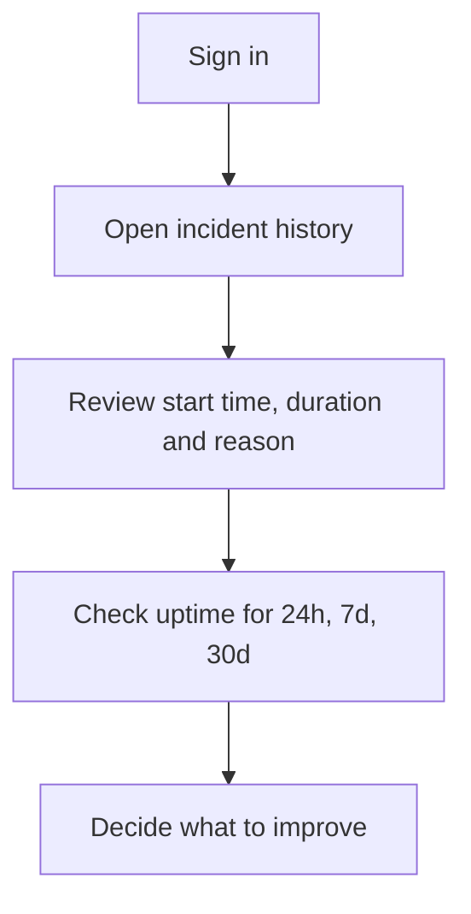

# CloudPulse User Journeys

A user journey follows one person from start to goal.

## Journey 1: Website owner, from sign-up to resolved incident

Persona: a shop owner who wants to know when the shop goes down.

| Step | What the user feels |
|---|---|
| Register and sign in | "This is quick and simple." |
| Add website | "I only had to type a name and address." |
| Alert arrives | "I know before my customers do." |
| Resolved | "I can see what happened and for how long." |

## Journey 2: Backend developer investigates a slow API

## Journey 3: Customer checks a public status page

## Journey 4: DevOps engineer reviews availability

