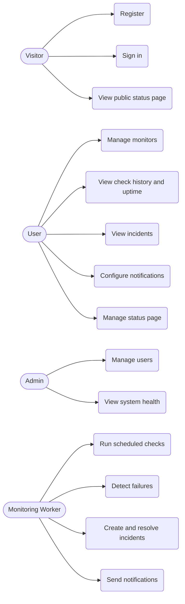

# CloudPulse Use Cases

## Actors

- **Visitor:** not signed in
- **User:** signed in
- **Admin:** manages the platform
- **Monitoring Worker:** a system actor that works automatically
- **Target Service:** the website or API being checked

## Diagram

## Use case table

| ID | Actor | Use case | Related requirements |
|---|---|---|---|
| UC-01 | Visitor | Register | FR-01, FR-02 |
| UC-02 | Visitor | Sign in | FR-03 |
| UC-03 | Visitor | View public status page | FR-69, FR-70 |
| UC-04 | User | Manage monitors | FR-11 to FR-20 |
| UC-05 | User | View history and uptime | FR-37 to FR-41 |
| UC-06 | User | View incidents | FR-49, FR-50 |
| UC-07 | User | Configure notifications | FR-57, FR-59 |
| UC-08 | User | Manage status page | FR-67, FR-68 |
| UC-09 | Worker | Run scheduled checks | FR-26 to FR-34 |
| UC-10 | Worker | Detect failures | FR-44 |
| UC-11 | Worker | Create and resolve incidents | FR-44 to FR-48 |
| UC-12 | Worker | Send notifications | FR-54 to FR-56 |
| UC-13 | Admin | Manage users | FR-72, FR-73 |
| UC-14 | Admin | View system health | FR-74 |
